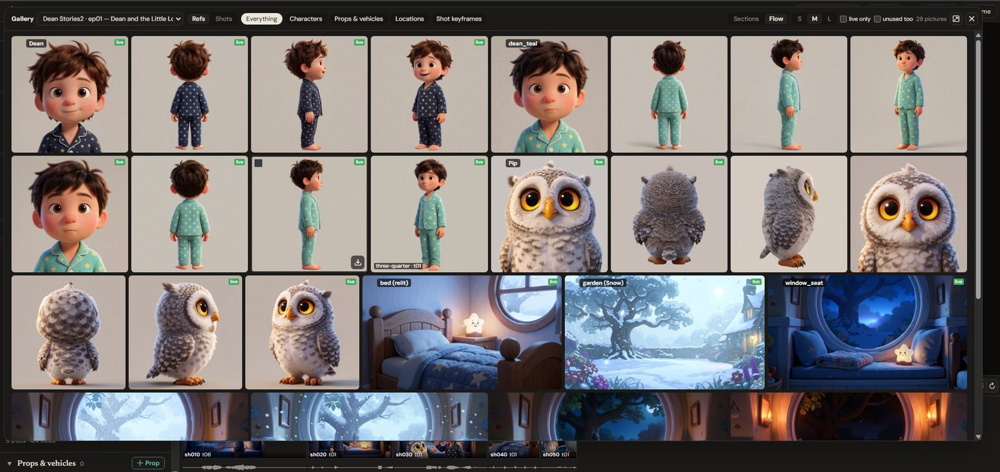

# The editor

The seriesmith editor is a page in your browser: `seriesmith serve` serves it at
http://127.0.0.1:8190. This is the guide to driving it: the order things happen in, what
every button does, and what each click, double-click and right-click means in each panel.

The page has the **Shots** and **Refs** tabs down the left, the **Viewer** docked in the
middle, the **Timeline** along the bottom, and along the top **Render on**, the **Jobs**
button (the queue), **Settings** and **Theme**. Everything else — the Script and Series
config, Series settings, the Inspector, Recording, Models, the **Gallery** and the dialogs —
opens as a floating window you can move, and dock beside the viewer.

**Inside ComfyUI** (seriesmith's node pack linked into its `custom_nodes`) the same editor
is three panels of ComfyUI's own: **seriesmith Shots** and **seriesmith Refs** in the
sidebar and **seriesmith Timeline** in the bottom panel. When that ComfyUI runs
seriesmith's queue, a bar on top of seriesmith Shots has **Render on**, **Jobs** and
**Settings**; the floating windows open over the canvas.

[INSTALL.md](../INSTALL.md) installs it. [AUTHORING.md](AUTHORING.md) is the format of the
two files you write. [API.md](API.md) is the HTTP contract underneath, for changing the
editor rather than using it.

## The order things happen in

The editor renders an episode. The writing is still yours, but it can make the episode for
you to write into:

1. **Install seriesmith**, the node pack and the model files ([INSTALL.md](../INSTALL.md)),
   or set up a cloud backend ([SETUP.md](SETUP.md)).
2. **Run `seriesmith serve`** (`--root C:\Shows` names your project folders) and open
   http://127.0.0.1:8190. Local renders go straight to your ComfyUI. `run_seriesmith.bat`
   does the same (setting itself up the first time) and opens the page in your browser
   (`run_seriesmith_ext.bat` opens it to your network too). To stop or restart it: **Settings → This server → Stop / Restart** (Restart
   starts it again under the .bat launchers, and the page reloads), `seriesmith stop
   [--restart]`, or Ctrl+C. A stop closes the page's connection and writes the queue's
   journal first, so it's quick, and jobs on Router are picked up on the next start.
3. **Open Shots → the episode's name at the top → Browse and add new…** and add the
   folder that *contains* your episode folders (the root), then pick the episode from the
   same dropdown.
4. **No episode yet? New episode…** in that same window writes the two files for you — see
   below. Otherwise write them yourself: `Shows\ep01\series.json` and `Shows\ep01\ep01.md`
   ([AUTHORING.md](AUTHORING.md) opens with a complete pair to copy).
5. **Build.** This runs `build` for both passes and fills the shot bin.
6. **Go to Refs and make the references** — character sheets, props, plates, voices.
   Renders are blocked until the pictures a shot needs are on disk, so this comes before
   rendering, not after.
7. **Come back to Shots and render.** Each take is a job: watch them in **Jobs**.

**Proxy or final.** The proxy pass is the same shots at the same seeds, rendered small and
cheap: it tells you whether the cut works, the timing lands and the characters hold, for a
fraction of the time. A proxy take is no preview of its final, though, and most work
renders final and re-renders what's wrong, so a page opens on `final` until you choose one,
and an episode opens on the pass that has its takes. On Seedance 2.5 a proxy take is a
**draft** whose final can be made from it exactly as drawn (**Finals from drafts**,
below).

## Simple mode

**Simple / Advanced** at the top of the sidebar. Simple is for making clips without
setting up a series: the sidebar becomes one **Make** panel and the Refs tab, the
settings and the text windows wait in Advanced. It is remembered in this browser.

- **Project**, the panel's title: its name is a dropdown of Simple's projects (a series'
  episodes open in Advanced), cut off at the edge when it's long. Its last choice, **Browse
  and add new…**, opens **Project folders**, where **New series/project…** makes one, a folder of
  its own (`<Name>/<name>/` in the folder you are in), so its clips, people and places stay
  together. An episode of a series opened from there switches to Advanced.
- **A clip**, **A picture** or **Several shots** (or **A series…**, the series wizard).
- **What happens?**: the prompt, as you'd describe the shot to a camera crew, and in the
  same card:
  - **Who**: **select…** people by their picture, or **+ Create** someone: a name, a
    description and, if you have one, a picture of them (it is taken in and used as it
    is; without one it is made from the description). Once added, they are in Who.
  - **Where**: **from description** (the prompt is the place, and each clip imagines it
    its own way), a place picked by its picture, or **+ Create** one to keep: a name and
    a picture you have, or one made from words, so it looks the same in every clip that
    picks it; once added, it is the clip's Where. Decided later that a place should recur? Right-click the clip at a good
    frame in the viewer (the picture itself, not its thumbnail), **Character or place from this
    frame…** ([below](#a-character-or-a-place-from-a-frame)).
  - **Said** (a clip with people in it): the lines, under who says them.
- The settings: **Model** (the video model, what each is good at in its tooltip, this
  machine's default marked: the one picked in Settings, else the first installed, H3 first;
  for a picture, the image model, Krea 2 first the same way: an edit model draws the
  people and the place from their pictures, a text-to-image one from their words),
  **Framing**, **Length** and **Size**. Several shots has a row per shot instead (what we
  see, framing, length), in order, sharing the people and the place.
- **Generate** (**Generate N shots** for several) queues one take, or one picture; another
  click, another.
- **Length**: a box for seconds, and beside it **lengths**, the ones the shot form offers
  (each with what it suits), to fill it from; `auto` fits the dialogue, and LTX-2 can
  choose its own (`model`). The shot form and the new episode wizard ask the same way. Each model renders on its own frame grid, so under it is what the model picked
  makes of it: rounded up (1.62 s is 4 s on Seedance), and past the model's longest, its
  longest.
- **Size** is the clip's picture size for the pass you're on (proxy or final): width ×
  height in pixels, typed or filled from **sizes** beside them (H3's 1344×768, 480p, 720p,
  1080p, their vertical sizes, square), starting at the project's. **Generate** renders at
  what the boxes say, as the model takes it (H3 needs multiples of 32: 1280×720 is
  1280×704): a clip at another size than the project's keeps it as its own size override,
  the one Inspect shot shows and saves. **Save as the project's size** (there when the boxes
  differ) makes it every later clip's. Under it, what another model picked for the clip
  makes of it. The New take dialog and the inspector's override ask for a size the same
  way, their boxes empty for the shot's own.

Queuing makes whatever pictures the clip still needs first (a person's, the place's), on
the same queue, and the takes once they are made; **Your clips** lists them, newest
first: a clip plays its newest take, several shots play cut together, a picture opens
its pictures. Underneath each project is an ordinary episode, **Clips**
(`Clips/clips/` in your first project folder) or one of your own: each clip is a shot of
it, so everything in Advanced works on it too, and a clip can later go into a real series. **A series…**
starts the series wizard.

## Shots

### The toolbar

The Shots and Refs tabs open as Simple mode does: the episode is the panel's title (its
series above it), its name a dropdown of every episode, whose last choice, **Browse and
add new…**, opens **Project folders** (add or remove roots, open an episode, New episode…,
New series/project…, Import series…). Beside it on the Shots tab, **Rescan the project roots**
(after adding an episode folder outside the editor) and **Simple / Advanced**. The
timeline keeps a small dropdown of its own, with the same choices.

The **refresh** beside the head reads the episode again from disk and rescans the project
folders. Under it, the Shots toolbar, its buttons in groups, left to right:

| Icon | What it does |
|---|---|
| **+ Shot** | **Add a shot** after the selected one, as a form (below) |
| pencil | **Edit the selected shot** as a form |
| sliders | **Inspect the selected shot** |
| file-edit | **Edit the episode's script** — opens the Script window |
| cog | **Series settings** — the series config as a form |
| book | **Edit the series config** (`series.json`) as text |
| volume-up | **Recording** — attach a dialogue recording and time the script against it (`align`). Lit when the episode has one |
| play | **Play all** — the cut, played from its takes, no export needed |
| film | **Open the timeline** |
| speech bubble | **Issues** — the pass's notes (below), with how many are open |
| images | **Open the Refs tab** |

Under it, the episode's card: **Model:**, the episode's video model (below), the row
that works on the pass: **proxy / final** (which pass you are looking at and rendering),
**Build** (runs `build` for both passes from the script and series config), **Re-render
stale** and, in proxy, **Finals from drafts**; then **Generate missing**, and how far
through the pass it is (done of total, failed, how long a shot takes, how long is left).

Beside the filter, **List / Board** (remembered in this browser): the list has a row per
shot, its takes under it; the board shows each sequence as a grid of its shots'
pictures (hover scrubs one, click selects, double-click plays, right-click as a row).
**Gallery** opens every take of the episode, large ([The gallery](#the-gallery)); a
sequence's header, double-clicked, opens it on that sequence.

### The episode's model

**Model:** is the model every shot without one of its own renders on, with whether it is
ready on this machine. Its list is grouped by where a model runs: **Your GPU** first, then
**Comfy Router (paid)**, as every model picker in the editor is. Choosing one here is the
episode's (kept in `overrides.json`); the list gives the line to put in `series.json` to
make it permanent, and **Use series.json's** goes back. A model that isn't ready says what
it lacks, and **What's missing** opens its files in the Models window. **Add / validate
models…** at the foot of the list opens the Models window (below).

### New series, new episode

In **Project folders** (**Browse and add new…** in the episode dropdown), browse to a
folder and press **New series/project…** (a show of its own, in a folder made inside this one; in
Simple mode it asks only for a name and makes a Simple project) or
**New episode…** (in this folder: the show's folder, not an episode's). Either opens a
short wizard:

1. **Where**: for a new series its title and its show folder (made from the title); the
   episode's name (the next number there, `ep03` after `ep02`) and its title. When the
   folder already has episodes, it says so: the new one continues that series.
2. **Series** (a new series only): its id, the video model, the final and proxy sizes
   (864×480 by default), the look, how dialogue sounds and the speech pace. Everything
   else is in Series settings, any time. **Look** offers presets as pictures, the same
   woman in a red coat in each (prestige drama, neon noir, 1970s film, documentary, black
   and white; genres: western, thriller, road movie, horror, fantasy, romance, war,
   Technicolor musical, 80s VHS; 3D animated, 2D cartoon, anime, stop-motion, watercolor,
   graphic novel…): one fills the line, which stays yours to edit, as it is in Series
   settings. A genre's picture shows its world (a frontier town, a desert highway), but the
   line is only the look (light, lens, grade, stock): your locations and characters decide
   where the story is, so a western look on a city street is a dusty, sun-bleached city. **Build the look** under
   them writes the line from its parts, a row of pictures each: **Medium**, **Camera**,
   **Lens**, **Film / sensor**, **Light**, **Grade**. Each pick adds what a director of
   photography would say of it ("anamorphic lenses: oval bokeh, horizontal lens flares…");
   a second click on a pick clears it, and a drawn or animated medium folds Camera, Lens and
   Film away. A look preset sets the rows too, so you can start from one and change a part.
   The picks rewrite the line only while it's still theirs: once you edit it by hand they
   leave it alone, and **Use the built line** puts theirs back. The picks are kept in the
   series config (`style.look_parts`). **Save as a preset…** under the line keeps it (and
   its picks) as a look of yours: it is offered under **Yours** in every show on this
   machine, and its ✕ removes it. Until it has a picture its tile shows its words; the
   picture button on the tile gives it one, three ways, none of them automatic: **Render
   it** on the sample scene on a model you pick (the woman in red at the tram stop, as the
   built-in looks are, so the tiles compare), take it **from your work** (a frame of the shot
   take selected in Shots, at the second you say, or the picture selected in Refs), or
   **import a picture** of your own. A relight of yours gets one the same ways; rendered,
   it's an edit of the sample street or of the woman on it, on an edit model.
3. **Cast and places**: who and where the episode is about — a character (name, design,
   voice), a location (a short name and its description), a prop or vehicle —
   each with its picture path filled in from the show's layout. A next episode carries its
   neighbour's whole cast over, so you add only who and what is new.
4. **First shot**: where it happens (the first sequence's location), who's in it, size,
   length, what happens, dialogue, camera and sound. The shot form adds the rest.

**Create** writes the two files in one go: a series config of the episode's own (a next
episode's is its newest neighbour's, with the new cast added) and the script. The episode
opens and builds, so its shots are there and the pictures it needs are listed as missing,
which is the next thing to do (the Refs tab). The paths are `../refs/...`: **one `refs`
folder beside the episodes, shared by all of them**, while each episode keeps its own
config. That is the layout to want: shared references, per episode cast lists.

The buttons are off when the folder isn't inside a project root: add it as a root first.
`seriesmith new Shows\ep02 --title "…"` makes an episode without the UI, from the newest
episode there or the starter pair (one character, one prop, one location, three shots).

One thing to know about sharing: a ref's *live file* is shared, its candidates and its pick
record are not. Picking a new take of a shared sheet in one episode replaces the file every
other episode reads, and their takes go `stale: ref`. That is usually what you want (fix
the sheet once, **Re-render stale** everywhere); when an episode genuinely needs its own
look for a character, give it an episode-local path (`refs/walker_ep02_sheet.png`, no `../`).
The Refs tab now warns you before that happens — see **Sharing refs between episodes**.

### Rendering the shots that need it

Two buttons beside Build ask for work in bulk:

| Button | What it queues |
|---|---|
| **Generate missing (n)** | every shot with no finished take and nothing queued — the first pass, and anything that failed |
| **Re-render stale (n)** | every shot whose newest take is out of date: the script, a reference, the preset or the target changed since it rendered |

**Re-render stale** is the other half of the edit loop: change a line, rebuild, and the takes
that no longer match are badged `stale` — this queues exactly those. It renders each shot at
its **built seed** (`stable_seed`, the one a first take uses), so the new take differs from the
old one by your edit and nothing else. A take that was itself a redo on a rolled seed goes back
to the built seed, which is the shot as it would render now.

A take badged only `unknown` (no provenance: it predates take sidecars) is left out — it isn't
evidence of anything. A shot with a take already queued is left out too. Hover the button for
the reasons behind the count ("12 script, 3 ref").

When some of the shots are missing refs or their model isn't ready, both open the **Render**
dialog first: what it will queue, what it would skip (missing refs are left out unless you
render anyway), **Video model class for this run** (a one-off, the shots' own targets
unchanged) and **Render on** (below). Otherwise they queue at once; a batch for a paid
backend, or of more than 8 renders, asks first.

### Finals from drafts

A Seedance 2.5 proxy take is a 480p **draft**, and for 7 days its 1080p final can be made
from it exactly as drawn: the same prompt, pictures, seed and sound. In proxy, **Finals from
drafts (n)…** lists the drafts the proxy cut uses, with their thumbnails; the shots with no
final yet start ticked, an expired draft is greyed out, and **Make n finals** queues them
(each a paid render, on the final pass). One at a time: **Make final from draft (1080p)…**
in a draft take's menu, which warns when the shot has changed since the draft.

### How far through a pass you are

Beside the filter box, the Shots tab reads out the pass as it goes:

```
37/240 · 12q · 24m · ~20s/shot · ~68m left
```

Shots with a finished take out of the shots in the pass, then takes queued, failed
shots when there are any, how long this run has been going, its rate, and what is left at that
rate. The timeline header shows the same line while anything is queued, since that is the
window you watch a long pass from. Hover either for the arithmetic.

The rate is **wall clock per finished take**, not how long a take takes: with 200 jobs on
the queue most of a take's own clock is waiting its turn, and that would read far slower
than the pass really goes. Takes from an earlier sitting don't count — a gap of more than
15 minutes starts a new run — and no rate is shown until two takes of a run have finished.
With nothing queued you see the last run's rate and no estimate.

### Shots and takes

The bin is grouped by sequence (`sq01`, `sq02`, …) with every shot under it and every take
under the shot.

- **Click a sequence header** to expand or collapse it.
- **Click a shot** to select it. The Script window follows the selection, and so does
  Inspect.
- **Click a take** to select that candidate; **double-click** opens it in the Viewer.
- **Use** puts that take in the cut. A take has to be finished and have video before it can
  go in.
- **The ⋯ button, or right-click anywhere on a shot or take**, opens the context menu. It is
  the same menu in the bin, the timeline and the viewer strip.
- **Import video…** (under a shot's takes, or in its context menu), or a video file dropped on
  the shot's row: a clip from anywhere (your phone, another tool) as the shot's next take,
  in the cut. See [Takes from outside](#takes-from-outside).

### The context menu

Everything you do to a shot lives here:

| Item | What it does |
|---|---|
| **Render this shot** | Queue it with its current settings, on its backend |
| **Render with settings…** | The same, after changing model, LoRAs, steps, seed or target for this run |
| **New take like this one…** | Re-render from *this* take's exact settings, with a new seed by default. The one you will reach for most |
| **Make final from draft (1080p)…** | A Seedance proxy draft's final, exactly as drawn (paid; see **Finals from drafts**) |
| **Cancel this render** | Stop a queued or running take |
| **Use this take** | Put it in the cut |
| **Play** / **Compare with…** | Open in the viewer; compare two takes side by side or with a wipe |
| **Play from here** | Play the cut starting at this shot |
| **Inspect shot** | The Inspector: model, overrides, refs used, refs missing |
| **Show in script** | Jump the Script window to that shot's lines |
| **Edit shot…** / **Add a shot after** | The shot form (below) |
| **Show missing refs (n)** | Which pictures this shot is waiting on |
| **Discard take…** | Move a candidate to `_trash/` — nothing is deleted, but the bin stays readable |
| **Show details** / **Copy path** | The take's sidecar, and its file path |
| **Upscale (2x)…** / **Keep upscale** / **Remove upscale** | The take's upscale (see **Finishing**); a kept one is left alone by Master |
| **Post-process…** / **Remove post** | Finish the take's upscale (see **Finishing**) |
| **Generate first frame** / **Clear keyframe** | Make (or drop) this shot's opening still |
| **Use previous shot's last frame as first frame** | Continuity: chain this shot onto the one before it |
| **Use this frame as the next shot's first frame** | The same, pushed forward |
| **Character or place from this frame…** | In the viewer, at a frame (see **A character or a place from a frame**) |
| **Flag to come back to** / **Unflag** | See **Flagging clips** |
| **Lock in the cut** / **Unlock in the cut** | Freeze a clip so it can't be moved, trimmed or re-picked |
| **Leave out of the cut** / **Put back in the cut** | The shot keeps its place in the script and its takes; Export, Play all and Master skip it |
| **Clear trims** | Back to the whole take |
| **Add issue…** | Note what is wrong with it (see **Noting what's wrong**) |
| **Audio from…** / **Back to its own audio** | This clip's picture with another clip's (or a file's) sound |
| **Move left / right in the cut** | Reorder (`Alt+←` / `Alt+→` in the timeline) |

### Editing a shot

**+ Shot** in the Shots toolbar adds a shot after the selected one; the pencil (or
**Edit shot…** in the context menu) opens the selected one. The form is the shot's lines
in the script as fields, in cards; each field's help is on its label (point at the ⓘ):

- **Shot**: its id, in the script's own numbering (between sh010 and sh020 a new one is
  sh015), and for a new shot the sequence it goes in, or a new sequence with its location.
- **Who** and **With**: picked from the cast in the series config, in order; **+
  Character** / **+ Prop** opens a new cast card. **Where**: another location than the
  sequence's; **+ Location** opens a new one. What a card saves goes straight into the
  field it was added from, and is in every picker at once: no reopening the form, no
  waiting for its picture.
- **Framing** (extreme close-up to extreme wide), **Length** (type the seconds or pick from
  **lengths**: the model's grid, or auto to fit the dialogue). Under them, **Framing, as
  pictures**: the nine sizes as the same woman on the same street, close to wide, each with
  how much the frame holds ("chest up", "head to toe"), and the four angles (POV, over the
  shoulder, low, high); open while the shot has no framing. **Lens** beside them (`lens:`):
  the look builder's lenses (spherical, anamorphic, vintage, wide, long, shallow focus,
  tilt-shift) and deep focus, for this shot only; **Lens, as pictures** shows each. Empty
  leaves it to the look. A lens is one sentence the shot's action opens with: it never
  changes the pictures, and with a plate as the reference the plate keeps its own focus and
  framing, so it may show little on H3. It shows most on models that draw the place from
  words (LTX-2, Wan).

Wherever the form (or the wizard, or the series settings' cast list) names someone or
somewhere, it shows their picture: a character's face, cut from the last panel of their
sheet (a whole body doesn't read that small), a group's or a prop's whole picture, a
location's plate; initials until there is one. **select…** and the location buttons open the
pictures to pick from, and pointing at a name shows it larger.
- **What happens**, **Dialogue** (a row per line: speaker, on screen / V.O. / O.S., how
  it's said, the words), **Camera** (type it, or build it from H3's moves: a move, its
  amplitude and its speed, and **where it goes**: what the move travels toward or reveals,
  "toward her face", "revealing the square", which the model frames the end of the move from;
  **Camera moves, as clips** shows each move as a short clip of the same street, played while
  you point at it, and picking one starts the line with it), **Sound**,
  **Extras**, **On-screen text**.
- **More** (the arrow, folded): music; **Video model class** (another model for this shot, with
  the Models button beside it) and right under it what that model loads, its **Model
  file**, **LoRAs** and **Steps**, each picked from what it can load; continuity
  (**Continues**); first and last frames (the default, generate, import, none, or **a
  picture you have…**, picked in the folder browser and kept relative to the episode); the
  audio policy, pace and profile.
- **LoRAs** is a chain: one row per LoRA with its strength, **+ LoRA** for another, applied
  in order (it writes `lora: a.safetensors:0.6, b.safetensors`). A hosted model has no
  model file or LoRAs to pick, and its steps read *none (the provider's)*.
- **On Comfy Cloud** (Render on **cloud**, or the series config's **backend** set to it),
  the model file and LoRA lists are Comfy Cloud's: its own files and any your Comfy
  account imported (Creator and Pro plans can import models and LoRAs). A LoRA that
  isn't there reads *(not on Comfy Cloud)*. The series config's fields follow its own
  **backend** field, as edited.

Beside the fields is what will render on the current pass, compiled as you type: the
model, size and frames, the dialogue's pace against the shot's length (with how long it
needs when it's tight), the build's warnings for this shot, and the prompt the model is
told (**copy** takes it whole). **Save** writes only this shot's lines into the script
(keeping its comments and any line the form doesn't know), with a history copy, and
rebuilds. **Save and generate** then queues a take on the current pass.

### Editing a prompt

**Inspect shot** is where a shot's prompt, seed, model, LoRAs and steps are edited, per
pass. It is a column of cards: the take (its picture, the buttons below), **Model** (the
shot's target), **Its pictures** (the refs its model reads), **In the cut** (trims, lock,
sound) and **Render settings** (what that model loads — model file, LoRAs as a chain,
steps — then the prompt and seed, with the built values folded under them). Save, then
render it — the take's card has two buttons for that:

| Button | What it does |
|---|---|
| **Generate (new seed)** | queues another take immediately: the saved override and a new seed, no dialog (**Generate** when the shot has no take yet) |
| **New take…** | opens the settings dialog first: what changes (from which take, the seed, a note, what to keep), the model, the output's size and pass, the prompt; its foot sums it up beside **Generate proxy take** (or final) |

> **Don't edit while that shot is rendering.** A finishing render refreshes the panel and
> your unsaved edit goes with it. Let the take finish (or cancel it) first.

Story edits — action, camera, dialogue — belong in the **Script** window instead, not in an
override. **Promote** moves overrides that the authored files can express back into them.

### Rendering one shot on another model

The Render dialog has **Video model class for this run**, and New take like this one…
**Model class**: a one-off, sent with the render, leaving the shot's own target alone.
Under it, the size and length are **that target's, for this shot** — not a preset. That matters because a target's frame grid decides the length: one
shot came out 448×256 at 124 frames on H3, 448×256 at 129 on LTX and 640×352 at 125 on Wan.
The dialog asks the server for the real numbers (P9), so what it prints is what you get.

An override you set on the shot doesn't travel: overrides belong to a target, so a one-off run
on another one uses that target's own defaults. The Inspector says the same thing the other way
round — when a field is overridden it shows **Built: steps 4 · model …**, what the build
compiled, so you can see what you have changed it from.

### Noting what's wrong with a pass

A proxy pass exists to show you structure: what happens where, and what is wrong. **P10** gives
that review a notepad — `<episode>/_issues.json`, filled while you watch and emptied when the
problems are fixed.

**While you watch:** press **n** (in Play all it notes the clip on screen and pauses; otherwise
the selected clip), or right-click a clip and choose **Add issue…**.
A small box opens with the shot and the take it is about; type a sentence and press **Enter**
(Shift+Enter for a second line). `i` and `o` are still trim-in and trim-out at the playhead, as
in any NLE, which is why the note key is `n`.

**The note button** (a speech bubble) in the Shots toolbar shows how many are open and opens
the list, where
**Copy export** puts the whole document on the clipboard for an assistant, **✕** resolves one,
and **Clear addressed** empties the ones whose shots you have already fixed. A clip with open
notes shows the same speech bubble in the timeline.

The same thing from the command line:

```
seriesmith issues Shows\ep05 --proxy --add sh0140 "Kell enters from the wrong side"
seriesmith issues Shows\ep05 --proxy --add-from notes.txt    # one "sh0140: …" per line
seriesmith issues Shows\ep05 --proxy                         # the list
seriesmith issues Shows\ep05 --proxy --export                # one document to paste
seriesmith issues Shows\ep05 --clear --addressed             # empty what is done
```

Each note **snapshots what produced the take**: the script's lines for that shot, the prompt the
pipeline compiled from them, the reference pictures it used, and the rendered file. That is
deliberate — the note is about the shot *as it was rendered*, so when you paste the export into
an assistant it sees what actually caused the problem, not whatever the script says after you
have started editing. Editing the script later never rewrites a note.

A shot that has since been rebuilt or re-rendered reads **(addressed)**. Nothing is deleted for
you: `--clear --addressed` empties those when you are satisfied, and an episode with no issues
has no issue file at all.

### Flagging clips to come back to

A note is for an assistant: it snapshots the script and the prompt so the script or series
config can be rewritten. When you only want to remember a clip, to re-render it or change its
prompt yourself, **flag** it instead. In Play all, press **M** to flag the clip on screen.
Playback keeps going, so you can flag clips in one pass through the cut. Press **M** again on a
flagged clip to clear its flag. Outside Play all, M flags the selected clip; the clip's menu has
**Flag to come back to** too.

A flagged clip has a pink flag in its corner, and the timeline's header counts them. Click the
count, or press **Shift+M**, to go to the next one. A flag changes nothing that is played or
exported. A locked clip can still be flagged. Each pass's cut keeps its own flags (in
`cut.json`), and Ctrl+Z undoes a flag like any cut edit.

```
seriesmith cut Shows\ep05 --proxy --flag sh0140      # --unflag to clear; --show lists them
```

### A profile for one take

New take… has **Profile…** beside the output's size when the series config has
profiles: picking one sets this take's model, steps and LoRAs from it and opens the
prompt with its look words and lens, as `profile:` would in the script. It changes this take
only (tick **Save these as the shot's override** to keep the model settings); to give a shot
or a sequence the profile for good, set it in the shot form or write `profile:` in the script.
Series settings' **Profiles** section makes and edits them: each has its look words, a lens,
the video model, steps, sla off, and LoRAs. Or start from a shot you've set up the way you
like: the shot form's **Save as profile…** (beside its Profile) keeps that shot's lens, video
model, model file, LoRAs, steps and `sla:` as a profile under the name you give, saves the
series config, and puts the shot on it (its own lines for those go, or they'd still win); Save
the shot to keep that. Other shots and sequences then take it with `profile:`.

### Keeping a take's frames

**New take like this one…** (and the Inspector's **New take…**, which is the same dialog) has
**Keep the frames (PNG sequence)**. It writes every frame of that take beside its mp4:

```
<episode>/renders[_proxy]/<shot>/frames/<shot>_t<NN>_000000.png …
```

For a shot that is right but for a frame or two: retouch those PNGs and re-encode the
sequence yourself. It costs ~2.5 s a shot and a few hundred MB a take, so it is per render
rather than a setting — the one-click **Generate (new seed)** never keeps frames.

A render is reproducible, so you can also fetch the frames of a take you already like:
re-render it with **that take's seed** (New take… → seed *same*, or type it) and tick the box.
Verified 2026-09-22 on this machine — two renders at one seed gave byte-identical frames and
mp4 — but it is worth confirming after a ComfyUI or driver update before you rely on it.

### The graph a model renders with

Each target renders a ComfyUI workflow, and the **Models** window (Model: → **Add / validate
models…**, or the sliders button beside any model picker) shows which copy of it is in force,
per target:

| It says | What that means |
|---|---|
| **repo** | the graph seriesmith ships, in `targets/<kind>/<id>/workflow.json` |
| **ComfyUI** | a workflow of that name is saved in this ComfyUI, and it wins |
| **$VAR** | that environment variable points at a file, which beats both |
| **edited here** | the graph in force isn't the repo's — ignoring everything a render
  patches anyway (model, LoRAs, prompt, size, seed, the episode's folder) |

To change how a model renders, press **Copy to ComfyUI**: the repo's graph is written into
ComfyUI's workflows under the name the target looks up. Open it on the canvas, change what
you like, save — from then on your saved copy is what that target renders. Your own graph
works the same way: save it in ComfyUI under that name (the Models window shows the name,
with a copy button). **Revert to the repo's copy** deletes the saved one and puts the shipped
graph back; it never touches an environment variable.

What a render sets per shot stays out of your hands: the prompt, size, length, seed, model
and LoRAs are written into the graph at queue time, so editing those widgets on the canvas
changes nothing. Everything else — samplers, extra nodes, upscalers, how the picture is
built — is yours.

From the command line: `seriesmith targets` prints the same per-target line, and
`--install-workflow <target>` / `--revert-workflow <target>` are the two buttons.

### The Models window

Everything about the models a show can use is in one window: **Model: → Add / validate
models…** in the Shots tab, or the sliders button beside every model picker (the shot
inspector's and Edit shot's video model class, New take like this one, Render's run target,
the Refs tab's refs / keyframes / voices models, and the series settings' four). It opens on
**All targets**:

- **Add a model**: a Comfy Router model from its catalog, or a workflow of yours (below).
- **Hosted models to try**: the Router models seriesmith ships untested (drafts). **Probe**
  one — a shot for a video model, a ref for an image model (one picture: a character's first
  view, or a keyframe to see its pictures go in) — look at the take, then **Enable** it: it
  joins the pickers in every show (kept in seriesmith's settings, `enabled_drafts`), and
  **Back to draft** takes it out again.
- **Your own models**: the ones added here, for every show or for this show only.
- Each model's **details** (its row in the table, or the picker at the top) say what files it
  needs and where its graph comes from, and carry its **Limits**.

### Comfy Router models

A hosted model needs your Comfy API key (Settings) and no GPU. seriesmith ships the ones it
has tried (Seedance, Kling, Wan, Veo, Runway, hosted H3; Nano Banana, Seedream, GPT Image,
Flux, Qwen, Krea 2 and more: **Hosted models to try** and the pickers list them) and a few
drafts. To add another: **Add a Comfy Router model…**

1. **Pick it.** Router's catalog, narrowed by typing any part of an id and by Video / Image
   / All (a guess from the name). A model already added says so; one whose name says
   text-to-video is marked (seriesmith draws from pictures, so it will be refused).
2. **Read it.** seriesmith reads the model's published schema and proposes where a shot's
   (or a ref's) prompt, pictures, length, size, seed and sound go. A field written for
   several models at once is flagged **Check this**, its text beside it: that's where a
   limit hides that the schema states only in prose (Seedance 2.0's 4–15 s, Wan 2.7's
   720P/1080P).
3. **Its limits**: the form below. Correct what the prose says.
4. **Dry run (free)**: the exact request for a shot (or a ref) you pick, nothing sent.
5. **Save** for every show (beside seriesmith's settings) or this show only. It's a draft:
   probe it, then enable it.

What a hosted take costs is the provider's; Router's own figure is recorded on the take when
it reports one (in the provider's units, which aren't Comfy's credits). While Router runs an
account's requests in turn, the Jobs window says where each is: *waiting at Router (#2 in
line)* or *running on Router*.

### Limits

Every video model, and every hosted image model, has a **Limits** card in its details: one
line, and **Edit**:

| | Local workflows | Hosted models |
|---|---|---|
| Length | the frame grid (LTX `8k+1`, H3 `17k+5`, Wan `4k+1`), the trained length | whole seconds: a range or a set |
| Size | the multiple (64, 32, 16), snap or refuse, the longest side, the pixels, or a list of the only sizes it takes | the resolutions (named, or WxH) |
| Prompt | — | the longest, in characters: a longer one loses its style line first, then the place and looks, keeping the action and dialogue |
| Pictures | needs a first keyframe | how many (a total, the plate counted), first and last frame, how they're sent (a link, inline, the Seedance library) |
| Sound | — | whether it makes any: off, its prompt has no quoted lines |

A change to one seriesmith ships is kept on this machine (settings `target_limits`) — **Back
to shipped** drops it; a change to your own model is written into its target.json.

### Your own model, from your own workflow

A workflow of yours can become a model, video (for shots) or image (for refs and keyframes).
Save the graph in ComfyUI, then **Add a model from a workflow…**:

1. **Pick the workflow, say what it makes (or leave it on auto), and Read it.** Auto reads
   the graph: a video node, a frame count or a video save makes it a video model; otherwise
   it's an image model. seriesmith works out which widget takes the prompt, the negative,
   the size, the length, the seed, the steps, the sampler and each model file.
2. **It can end in any save node.** SaveVideo, SaveWEBM, an animated WebP or PNG, Video
   Combine (with its sound), a frames saver, SaveImage, a node pack's own: the best of the
   graph's outputs (a video file, then an animation, then frames; a save before a preview)
   is the take, and seriesmith saves it in that node's place. When the node takes a finished
   video, the node making the video is the one replaced. Other outputs are dropped.
3. **An image model's LoadImage nodes are its pictures.** Without any it's text to image (a
   character's views, props, plates); with them it edits, and each take's pictures go into
   them in order — an edit's source, a keyframe's characters then its plate. Every take
   needs a picture, so an edit workflow is for keyframes and edits.
4. **Read the notes.** **Errors** stop it being saved (the graph itself is wrong);
   **warnings** are worth checking (the longest length is a guess, where the keyframe goes
   in, a model file seriesmith can't check); **notes** say how the graph was read (which
   node saves, links cut so a shot's value goes in, widgets left as you set them).
5. **Answer what no graph can state** (a video model: the frame grid, size multiple, fps,
   sound, whether dialogue is spoken) and **Save** — for every show, or this show only
   (`<show>/targets/<id>/target.json`). It's a draft until enabled; **Probe** it first.

`seriesmith target-from-workflow <workflow> [<episode>] --save` is the same thing without
the UI (`--save --every-show` for every show).

### A character or a place from a frame

It's in **the viewer**, the player above the timeline: double-click a take to open it there,
play or scrub it to the moment you like, and right-click **the picture itself** →
**Character or place from this frame…**. The same menu from a take's thumbnail, the
timeline or the shot list has no frame to take, so there it only says where to go.

- **A new character**: a name, who they are in the frame ("the woman in the red coat, on
  the left") and, if you like, what they look like (said in every shot they're in). The
  frame goes to an edit model (the series' own, or one you pick: FLUX.2 Klein edit, Qwen,
  ...), which cuts them out onto a plain background as their three-quarter view; their
  side, back and face views are then drawn from that one, each picked as it comes out,
  and stitched into their sheet.
- **A new place**: a name; the edit model takes the people out, leaving the place as its
  plate.
- **For one there is**: the frame, cut out (or as it is), as a new candidate of a
  character's view or a place, beside its pictures (and, for a character, its other views
  drawn from it too, as candidates); you pick which is live.

**Use the frame as it is** skips the edit. It all goes on the queue; the Refs tab shows the
candidates as they arrive, and any view can be made again from there.

## Refs

Used heavily at the start of a series and rarely afterwards, if the references come out
right. Every character view, prop, plate, voice and shot keyframe the series config and
script call for is listed here.

- **+ Add** at the top adds a character, group, prop, vehicle, location or voice to the
  series config, on its card (as each group's **+ Character**, **+ Prop**, **+ Place**,
  **+ Voice** does); **Series** opens Series settings.
- **Made with** names the models that make refs, keyframes and voice samples; **Change**
  opens their pickers: **Refs render with:**, **Keyframes with:** and **Voices with:** (a
  choice here is this episode's, kept in `overrides.json`, with the `series.json` line to
  make it the series default); a ref with its own model keeps it.
- **this episode / all / missing** filters the list; **List / Board** (remembered in this
  browser) shows the refs as rows that open to their candidates, or as a grid of their
  pictures, each group ending in an add tile. A click on a picture opens that ref in the
  list. A character shows its face (its face view's pick, else its three-quarter view's,
  else the sheet's face panel; a one-picture character, `sheet_panels: 1`, its whole
  picture), which tells the cast apart at a glance; the four-panel sheet is in its open
  row, and double-click opens it. A character marked one picture whose picture is a
  four-panel sheet says **sheet marked one picture**: renders send the whole strip, so set
  its card's Picture layout back to the four-panel sheet. (A card that takes a picture
  you have marks the character one picture only when the picture isn't a sheet's shape.)
- A shared ref whose live file another episode picked (the series' `../refs/` layout) says
  so when it's open, and lists that episode's candidates, read-only (each episode keeps its
  own): **From ep01**, the live one first. Double-click one to see it whole.
- **Click a ref** to expand it; **double-click the ref's row** (or its picture on the board)
  to open every picture of it in the [gallery](#the-gallery), its live one large; a group's
  header, double-clicked, opens the gallery on that group, and **Gallery** beside the
  filters on every ref.
- **Double-click a candidate** (one of the four view images) and it opens against the live
  one, for comparison.
- **Click a candidate** to see what made it: its model, settings and prompt. **show all**
  opens the whole prompt in a box to select (a click selects it all), and **copy** puts it
  on the clipboard, to run it somewhere else.
- **Right-click is your browser's menu here**, not the editor's context menu. The Refs tab
  has buttons instead.
- **Expand the prompt** (it shows the series config's wording) to edit it, change the
  model, add LoRAs, or change the seed and steps. Settings above the views are shared by
  all four; the prompt is per view.

### Making references

- **Generate** makes candidates. The view selector and the count beside it decide which
  view and how many, each with its own seed — **you do not have to redo all four views.**
  If only the back view is wrong, regenerate the back view.
- **Import…** takes an image from the machine `seriesmith serve` runs on, and you can drag a file onto a slot
  or use Upload. Hand-made and externally generated references are the expected case; the
  generators are the fallback.
- **Generate missing** fills everything the episode needs in one go. It does the pictures —
  **not the voices.** Generate a voice from its own ref row.
- **Clear** unpicks a ref; **Discard** bins a candidate.
- **Edit** a picture (a candidate, or the live one) and the edit window opens on its
  instruction. **Relight** above it is a row of presets shown as pictures, each the same
  sample place or figure under that light: time of day (dawn to night), weather (overcast,
  rain, fog, snow, storm), light (neon, moonlight, streetlights, firelight, police lights,
  emergency red, sunbeams, a flashlight) and, for a character's view or a prop, portrait
  light (Rembrandt, rim, top light, low-key noir, soft beauty, silhouette). A plate and a
  figure each get their own wording. Picking one fills the instruction, which stays yours
  to edit or replace; the edit model changes the light and keeps the rest. **Read it
  first:** a relight names where its light comes from, and the edit model can draw in what
  it names. The presets say "any lamps already there" or put the source off-frame, but a
  model can still add a lamp, a sign or a fire: cut what the picture hasn't got from the
  instruction (rather than adding "no lamps", which puts the word in all the same), and
  compare the result with the original.
- **Re-render…** on a sequence's header (Shots tab) renders all its shots again as new takes
  with the same seeds, so only what you changed (a relight, a character's new sheet) differs.
  Your takes stay; pick the new ones as usual. **Re-render stale** above the list does the
  same for every shot whose inputs changed, across the episode.
- **Relights of your own.** **Save as a relight…** under the edit window's Relight keeps the
  instruction you've written; on an edited take, **save as a relight…** beside its instruction
  keeps it with that take's picture as its tile. Yours are offered under **Yours** in every
  show (the edit window's Relight and a sequence's Relight…), for a plate or a figure as you
  saved them; ✕ on the tile removes one.
- **A whole sequence under another light**: **Relight…** on a sequence's header (Shots tab)
  relights every plate the sequence uses at once, for a flashback, a dream or a night
  version. Pick a relight picture or say it in your own words. Each plate becomes a new
  location (`street_dusk`), made on the edit model from the plate itself, so the place stays
  and only the light changes. The dialog lists what it will make before you start. **Point
  the sequence at the relit plates** (on by default) rewrites the sequence's location and its
  shots' `plate:` lines, so the next render uses them. Pick the takes in Refs as usual.
- **Turn** (**↻ Turn** at the top of a view's column: side, back or face) draws that view
  from one the character already has, the three-quarter if it's picked, by turning the
  camera around them on Qwen-Image 2.1 with the multi-angle LoRA
  ([FULL_SETUP.md](FULL_SETUP.md), "360s and turned views"). A new candidate, not picked:
  the same character from another side, rather than four views drawn apart.
- **Make 360** (a place's row, under its plate) outpaints the plate into a 360 panorama.
  Open it to look around and save a view as a new angle of the place.
- A character's sheet is stitched automatically once all four views are picked — or you
  supply a finished one, below.
- **A view's settings vs the character's.** Seed, model, LoRAs and steps set on a character's
  row are shared by all four views; open a view and its editor says which of the values on
  show it inherited ("Its steps come from Ada and are shared by all four views"). Change one
  there and it becomes that view's own; **Remove this view's own settings** drops only those
  and leaves the character's. A view's prompt has the series config's wording behind it, so
  **Diff** shows what you changed and **Series config** puts it back.

### A place's tour

A location (or one of its angles) with a plate has a **Tour**: pick a move (or write one),
set how long it runs, and **Run tour**. H3 moves the camera through the place from its plate
and holds; each held frame lands as one of the place's tour holds, and **Grab frame** in
the viewer keeps another. **Use** copies a hold in as a plate candidate of the location or
an angle; **Use and sharpen** queues a sharpening edit on it too.

### References you already have

Three routes, and all of them are supported:

1. **Copy the file into the folder** `series.json` names. This has always worked and still
   does: the build counts it, renders read it, and if you replace it later the takes that
   used it go `stale: ref` so **Re-render stale** offers them. The row says the live file was
   "put there outside the editor", which is not a complaint — it means there is no candidate
   behind it to compare or go back to.
2. **Drop one file on a slot** (or **Upload…**). A prop, a plate, a voice, a keyframe, one of
   a character's four views — and, since P8, **a character's row takes a whole 4-panel
   sheet**: drop it there, or use **Upload sheet…**. It becomes a candidate and goes live
   without being stitched, so a second one can sit beside it and you can switch between them.
   Picking all four views afterwards stitches over it; the row always says which of the two
   the live file came from.
3. **Drop the whole lot on the Refs tab** (or **Supply files…**, which also takes a folder).
   Every file is matched to a slot by its name and you get the table *before* anything is
   sent: what goes where and why, and what was left alone with the reason. Press **Supply n**
   and they upload one at a time, each going live. Nothing is guessed — a name that could
   mean two slots, or two files wanting the same slot, are listed as left alone for you to
   rename.

Names are matched against the file each ref already names in the series config
(`walker_sheet_4panel.png`), the ref's id (`walker.png`), a view's tag or word
(`walker_02_side.png`, `walker_side.png`), a plate (`highway_dawn.png`, `bg_highway_dawn.png`)
and a voice (`walker.wav`). A trailing `_v2` or `_final` is ignored. The extension decides
between a picture and a sound, so `walker.png` is the sheet and `walker.wav` the voice.

`seriesmith supply <episode> <folder> --dry-run` prints the same table from the command
line, which is the quickest way to fill a show whose pictures are already on disk.

You can also paste an image onto a slot with Ctrl+V.

### Sharing refs between episodes

With one `refs` folder beside the episodes, a ref's **live file is the whole show's** — in a
real series that is every ref, so the editor does not badge them all as "shared". What it
tells you instead is when the file that is live *isn't your episode's doing*:

| On the row | What it means |
|---|---|
| **from ep03** | ep03's pick wrote the file that is live now |
| **not from here** | nothing has a candidate for it: it was copied in by hand, or replaced outside the editor |

**Generating candidates never touches it.** Candidates are private to the episode, and the
one automatic pick only happens for a ref with no live file at all. So regenerate freely — it
is picking, uploading, supplying and clearing that the other episodes feel.

You get a confirm when:

- **you pick over a file another episode picked.** Their pick loses and their takes go
  `stale: ref` — they can re-pick their own take to get it back.
- **you pick over a file nothing has a candidate for** (the "not from here" case). There is no
  copy anywhere: this one is gone for good, which is why the wording is blunter.
- **you clear, or discard the take that is live, on a shared file.** That *deletes* it, and
  every episode that needs it is blocked until something is picked again — so this one asks
  whoever owns it.

Picking over your own episode's pick says nothing, which is the case you are in all day while
making refs. On the command line, `seriesmith refs <episode> --clear <ref>` refuses a shared
live file unless you pass `--yes`.

### Choosing a model

The target picker sets which image model generates. They are not interchangeable:

| Target | Reads references? | Notes |
|---|---|---|
| `krea2` | No | Text to image. The default, and it holds a character across four views well because they share one seed |
| `z_image_turbo`, `flux2_klein` | No | Text to image |
| `moss_image_sft`, `moss_image_base` | No | MOSS-Image: text to image, good with lettering and layout; the SFT is the one to draw with, the base is for LoRAs trained on it |
| `flux_kontext` | One | The only edit target that takes a negative prompt |
| `flux2_klein_edit` | Up to 4 | The default for keyframes when installed |
| `minimax_h3_still` | Up to 9 | The video model rendering 5 frames and keeping the first |
| `qwen_image_21` | Up to 16 | Text to image *or* an edit, decided by whether there is anything to edit from. The only one with a usable denoise; cfg, scheduler and negative prompt are ordinary settings |
| `flux3_klein` | Up to 10 | FLUX.3 Image Klein: text to image *or* an edit, as `qwen_image_21`. cfg, scheduler and negative prompt are ordinary settings |
| `flux3_klein_turbo` | Up to 10 | The step-distilled FLUX.3 Klein: the same in 16 steps at cfg 1, so no negative prompt |
| `fasth3_omni_still` | Up to 9 | FastH3 Omni rendering 5 frames and keeping the first, as `minimax_h3_still` |
| `fibo2_dev` | Up to 4 | Fibo 2.0: text to image *or* an edit (relights too), 50 steps at cfg 5. Non-commercial licence |
| `fibo2_edit_turbo` | Up to 4 | Fibo 2.0's 4-step edit model: edits only, so not for a character's first views |

The hosted image models (Nano Banana, Seedream, GPT Image 2, Flux Kontext Pro, Krea 2 on
Router, …) are under **Comfy Router (paid)** in the same pickers; most of them take
pictures to edit from. `seriesmith targets --kind image` says which are installed.

### Wardrobe variants

A subject with `of:` in the series config is the same character in different clothes, with
its own sheet ([AUTHORING.md](AUTHORING.md), "A wardrobe change is a new subject"). How its
views are made depends on the model:

- **On an edit model** (`qwen_image_21`, `flux3_klein`, `flux3_klein_turbo`, `flux2_klein_edit`, `flux_kontext`,
  `minimax_h3_still`, `fasth3_omni_still`, `fibo2_dev`, `fibo2_edit_turbo`) each view is generated **from the character's own matching view** —
  the towel's back panel is an edit of their back panel.
- **On a text-to-image model** there is nothing to edit from, so it draws the variant from
  its `design` **on the character's seed**. Closer than a fresh draw, but not the same
  thing.

**Order matters.** A whole pass plans every job before anything is picked, so in the first
pass a variant has nothing to edit from and comes out cold. Run the pass, let the
character's views pick, *then* regenerate the variant. To check which happened, select the
candidate and read the **drawn** row: `edited from Dana (three-quarter)`, or `from the
prompt alone`.

## Importing a series

**Import series…** (in **Project folders**, beside New series/project… and New episode…) brings a
whole season in at once:
pick the scripts (`Files…`) or a folder of them (`Folder…`), with one series config for the
lot or one per episode (a `series.json` beside a script, or named after it). Each script
becomes an episode folder under the show you choose, named from its header; the import
says which went in and why any didn't (a script with no header, a config that doesn't
build it). Then build and render them as any other episode.

## Features: installing models, node packs and tools

**Settings → Features…** lists what can be added to this install, grouped as
[FULL_SETUP.md](FULL_SETUP.md) has it: video and picture models, H3's sparse attention,
voices, upscaling, post-processing, 360s and turns, seriesmith's node pack and ffmpeg.
Model files and ffmpeg it installs; a node pack or Python package it says how to put in
(ComfyUI-Manager, or the pip command to copy).

- **Each feature** has a checkbox and a status: **Installed** (ticked, greyed), **Partly
  installed**, **Not installed**, or **Restart ComfyUI** (a node pack is in, not loaded
  yet).
- **The chevron** lists the feature's files, packs and packages, each with where it goes
  and its size. A gated file links its licence page.
- **The foot** adds up what the ticked features still download; each file shared between
  features counts once.
- **A node pack or Python package** missing shows how to put it in under its feature,
  with a copy button: ComfyUI-Manager for a pack, the pip command for a package. A
  feature made only of those can't be ticked.
- **Install** queues the rest. The card on top follows each item (a download's bytes)
  and has **Stop**. A stopped download resumes next time. When seriesmith's own pack was
  linked, it says to restart ComfyUI.
- **Gated files** (LTX-2.5, FLUX) need a **Hugging Face token** in Settings and their
  licence accepted on Hugging Face. Without them the file fails, saying which.
- **What's missing** has an **Install** button beside each file with a known download
  (it opens Features to show the progress); beside a missing node it says to install the
  pack that provides it with ComfyUI-Manager.

## Where shots render

Every render, reference, voice, upscale, post and tour is a **job**, and a job runs on a
**backend**: `local` (your own ComfyUI), `cloud` (Comfy Cloud),
`deployment:<target>` or `router` (a hosted model). **Render on** in the top bar (on top of
seriesmith Shots inside ComfyUI) picks one for every render from the page this session, and
the Render dialog's own row for that request: every backend this machine is set up for, a
greyed-out one not answering. Left at **each shot's own**, a shot uses its own (an
override), the episode's, the series config's `series.backend`, else its target's first. A
hosted target (Seedance, Krea 2 on Router) only runs on `router`; a shot sent somewhere its
target can't run says so in its error ([SETUP.md](SETUP.md) sets backends up). The take's record says
where it ran.

## Jobs

The **Jobs** button (top right) shows how many jobs are queued and running; it opens the
queue:

- One lane per backend. Your own ComfyUI runs one job at a time; a cloud backend several.
- Each job shows what it is (`ep02 sh140 t03`, a ref view, an upscale, a tour), its
  progress, and its log (where it ran, what it held or started from, how it ended).
- **Cancel** stops a running job or takes a waiting one off the queue (its take is marked
  failed, `canceled`). **Earlier** / **Later** reorder a waiting job; a lane can be
  **paused** (**Pause** / **Resume**), which lets the running job finish and starts nothing
new.
- **Again** runs a finished job once more, as a new take with the same settings. On a
  paid backend it first asks whether the old run finished after all (a lost connection,
  not a failed run): if it did, that run is collected into its take instead of paid for
  twice.
- A job that waits for another says so: a `continuous:` shot waits for the shot it
  continues, a post for its upscale.

The queue lives in the server: closing the page leaves it running, and reopening it shows
where things are. What it would lose to a restart, it doesn't:

- **A restart.** The queue keeps a list of its live jobs (`queue.json` beside the
  settings file). When `seriesmith serve` starts again, a job that had reached its backend
  is found again by its run's id and collected as if nothing happened ("(found again)" in
  Jobs): on your ComfyUI (by its prompt id), on Comfy Cloud, a deployment or Router.
  A job still waiting in seriesmith's queue (your ComfyUI takes one at a time, so after a
  big **Generate missing** most are) had cost nothing: it is queued again by itself, in the
  order it was queued, keeping its take number, and nothing is left failed.
- **A dropped connection.** A run's backend out of reach (the network, ComfyUI
  busy loading, a 5xx) is asked again for up to 15 minutes before the run is given up on;
  the job itself goes on where it runs.
- **A hung job.** Each kind of job has a generous time limit (a render 2 hours, an
  upscale 4, a post 6, a ref picture 30 minutes, a tour 1 hour); past it, it is stopped and
  failed, saying so, so a stuck ComfyUI doesn't hold its lane for good.
- **A full disk.** A job that needs more room than is free where its files go (a render
  1 GB, an upscale or post 3 GB) is refused before anything is reserved.
- **Paid runs.** Runs on Comfy Cloud, Router or a deployment are counted (**paid runs**
  in the Jobs window's title, with **reset**); a batch of them asks first, and **Settings**
  can cap them per session.

## Settings

**Settings** in the top bar (on top of seriesmith Shots inside ComfyUI) is this machine's
own, never the series': the **Comfy API key** (from platform.comfy.org; it turns on Comfy
Cloud and Comfy Router, and paid use is billed to that account), the Cloud address, **Paid
runs per session** (the cap; empty is none; under the key, while Comfy's SDK installs for
Cloud and Router, how that is going, with **Install** if it failed), where your **ComfyUI** is, the **Video
model** and **Picture model** a series naming none renders on (what seriesmith found
installed in ComfyUI, unless you pick one), whether local renders go **through
comfy-api-proxy** (advanced; off: straight to ComfyUI), **Features…** (below), the
**Hugging Face token** for gated downloads, **Folders** (your own ffmpeg; ComfyUI's
folder, when it can't be asked), **Use from an LLM (MCP)** (how to add this install to an LLM
client you use: its command line, the JSON block, the command itself, each to copy, with a
read-only switch; nothing is installed and nothing runs until the client starts it:
[COMMANDS.md](COMMANDS.md#an-llm-driving-seriesmith-seriesmith-mcp)), and **deployments** (a model built into a Comfy deployment of its own, which then
shows in **Render on** as `deployment:<model>`). Saving applies at once. They live in
`%APPDATA%\seriesmith\settings.json`; a value the environment sets (`COMFY_API_KEY`, ...)
wins and shows as such. On the standalone page opened on the PC that runs the server,
**This server** has **Stop** and **Restart**.

## The viewer

Docked in the middle of the page: the selected shot's takes (step with `←` `→`, compare two
**side by side** or under a **wipe**, **Play all** for the cut), a ref's candidates, a
location's tour (keep any frame as a hold), and a 360 in its own viewer. Drag its tab out to
float it, or dock another window beside it.

**Play all** has its own **Loop** (the cut starts over at the end; remembered).

**Full screen** (the button by Close, or `F`) puts the viewer on the whole screen, its
controls with it; `F` or `Esc` brings it back. The sidebar's right edge and the timeline's
top edge drag to resize the panes (double-click one to put it back); the sizes are kept
in this browser.

## The gallery

Every picture of the episode's refs, or every take of its shots, large, in one window: where
the sidebar shows one ref or one shot at a time, small, the gallery shows them all, every
version with the one in use badged, and steps through them with the arrow keys.



**Opening it.** In Refs: double-click a ref (on its live picture), a group's header (on
that group), or **Gallery** (every ref). In Shots: double-click a sequence's header (on that
sequence), or **Gallery** (every take). Inside, **Refs / Shots** switches between them, and
the episode list switches episode with it open.

**The grid.** In Refs, chips for the groups (**Everything**, Characters, Props & vehicles,
Locations, Shot keyframes) and **live only** (each ref's live picture); in Shots, a list
(**Every sequence**, **In the cut**, then each sequence) and **cut only**. Each ref or shot
is a section, its versions newest first, the one in use badged **live** or **cut**, a take
with a fresh upscale **2x**; its name, clicked, narrows to it (the chip with **×** widens it
again). **Sections** or **Flow** (one run of rows, each one's pictures together, its name on
the first) and **S / M / L**, both remembered; every picture at its own shape. Hover a picture
for its view and take, a take's for what happens in the shot, and a take scrubs its frames
under the pointer. Pictures load as they come into view.

**A picture or a take, open.** A click opens it over the grid; **← →** step through the
whole grid in order, across refs and shots (**Home / End** to the ends), and **Esc** goes
back to the grid where you were. A take plays: **space**, **,** and **.** a frame, the
transport under it, **2x** for its upscale (the same switch as the viewer's and Play all's).
Beside it, what it was made with:

- a picture: its model, file, seed, settings, when it was made, the prompt it was drawn with
  and what it was **drawn** from (each picture named a link to that ref's pictures);
- a take: the prompt **it** rendered with (its own record, read when it opens, not the
  shot's prompt now), its model, LoRAs, seed, steps, size and length, its upscale, and
  **the pictures it was sent**, each a link to that ref's pictures, **changed since** where
  that picture has been redrawn since the take.

Its buttons: **Pick** / **Use** (make it the live picture, or the cut's take), **Regenerate**,
**Compare with live** / **Compare with cut** (side by side in the gallery, in step; **C**;
it stays on as you arrow through), **Download**, **Copy prompt**.

**Regenerate** makes a new one like it with a new seed: a picture with its own prompt, model,
LoRAs, steps, cfg, sampler settings and size (an edited one, the same edit of the same
picture); a take, the shot as it is now, the take its parent (as the Inspector's **Generate
(new seed)**). A picture nothing drew (imported, a frame, a 360, a tour's hold) has none.

**Saving.** Each picture has a tick and a download on hover. Tick some (**shift**-click ticks
a range; with some ticked a click ticks), and the header says how many, with **Download**,
**Select all** and **Clear** (**Esc**). One saves as itself; more save as one zip,
`<episode>-gallery-<n>.zip`, made by the server (pictures whole, a take's video, or its
upscale under 2x). The selection is kept as you change what's shown, and cleared with the
episode.

**Other episodes' pictures.** A ref other episodes share (the series' `../refs/` layout)
shows their pictures after this episode's, badged with the episode, read-only here (each
episode keeps its own: no Pick or Regenerate, but Download, Copy prompt and Compare). They're
read as each ref comes into view, so the count reads **"29…"** while some are still to come.
**unused too** adds the refs no shot of this episode uses: another episode's cast and places,
with their pictures.

## The timeline

The cut as an editable track, along the bottom of the page.

- **Drag a clip** to reorder it; **drag its edges** to trim frame by frame.
- **Drop a take from the gallery, or a video file**, onto a clip (that shot's take) or between
  two (a new shot there): [Takes from outside](#takes-from-outside).
- **Double-click** opens the clip; **right-click** is the same context menu as the bin, so
  everything above — new takes, keyframes, locking, audio — is available here too.
- **Ctrl + wheel** over the track zooms (or the slider).
- **Turn on the waveform lane** (the wave button) to see the audio under the cut. Useful
  with a recording attached.
- **Export** assembles the pass's review cut into one mp4 (missing shots are skipped);
  **2x** beside it assembles from the takes' upscales. A clip without a fresh one (none
  yet, a stale or failed one) is upscaled first, by the series config's `upscale.master`
  recipe as Master does (each take's defaults without one), after saying which; the
  export starts by itself when the last upscale is in, and a failed one stops it.
  **Titles** assembles the whole cut and puts the series intro and outro around it with
  the episode's title (`_titles/INTRO.mp4` and `OUTRO.mp4` in the show folder; into
  `<episode>/publish/`), and its **2x** upscales what's missing the same way.
  **Play all** watches the cut straight from the takes without assembling anything.
- **Cut** (the menu in the header): undo / redo, **Reset order**, **Clear trims**, copy the
  order, trims and audio from the other pass, **Upscale the cut (2x)…**, **Post-process the
  cut…**, **Master…** and the waveforms. The header also counts the clips flagged (click:
  the next one), moved out of script order, and missing refs (click: the Refs tab).

### Takes from outside

A shot's take doesn't have to be one seriesmith rendered.

- **A take from the gallery**, dragged onto the timeline. Drop it **onto a clip**: that shot's
  own take is simply picked; another shot's is copied in as a new take of the clip's shot, and
  picked (the clip stays where it is). Drop it **between two clips** (the wider marker): a new
  shot goes into the script there, after the one on the left, numbered as **Add a shot after**
  numbers it (`sh015` between `sh010` and `sh020`). Its lines are the dragged take's shot's
  (who, with, size, action, dialogue; not its continuity), with a comment saying where it
  came from, and its `dur:` is the take's length. The take is copied in as its first take and
  the clip appears where you dropped it. The script is saved as any edit is (the old one kept
  in `_history/`), and rebuilt.
- **A video file**, dropped from your computer onto a clip, a shot's row, or with **Import
  video…**: the shot's new take, in the cut. Dropped **between two clips**, the shot form opens
  there with the clip's length filled in. The form wants the action written (what happens in
  the shot: what a render of it would be told) before it saves. **Save** makes the shot with
  the file as its take. **Save and generate** does that and also queues a render of the new
  shot from what you wrote, a second take beside the imported one (the imported one stays in
  the cut); use **Save** to keep just the file.
- An H.264 mp4 goes in as it is. Anything else (ProRes, HEVC, a .mov, .webm or .mkv) is
  converted to H.264 at master quality first, so it plays in the editor; the original isn't
  kept. Up to 4 GB.

An imported take keeps its own length, frame rate, size and sound: the timeline, Play all and
the assembled cut use them, and a clip of another size or rate is fitted to the episode. It
has no seed or prompt, so it is never marked stale and **Generate (new seed)** on it renders
the shot as the script says. Its badge says **imported** (the file's name on hover) or **from
sh020 t03**; the gallery's viewer says the same. An upscale of it is the pixel method or
SeedVR2 (a re-sample needs what a render keeps).

Setting a shot's keyframe from its neighbour is how you make a cut continuous: use the
menu's **Use this frame as the next shot's first frame** on the take you like, and the
next shot starts where this one ended.

### Finishing: upscale, post, master

A take's menu has **Upscale (2x)…**: a re-sample on the take's own model (more detail, the
same performance) or an upscale model, its own audio kept. **Post-process…** then finishes
that upscale: an enhance step (draft, production or cinematic) and motion blur. Each
dialog follows the series' recipe (`upscale.master`, `post.master`, in Series settings) or,
with **Choose for this run**, your choice. The Cut menu does the same for the whole pass.

**Master** (the timeline header, or Cut → **Master…**) shows what each shot of the cut is
against the series' upscale recipe, queues the upscales it needs, then assembles the master
into `<episode>/master/`, with the intro and outro when the show has `_titles/`. It is a
job the server keeps, so closing the dialog or reloading the page doesn't stop it. **Keep
upscale** on a take makes Master leave that upscale alone.
[POST_PROCESSING.md](POST_PROCESSING.md) has the detail.

### Keyboard

These work while the timeline or Play all has focus, and never while you are typing in a field:

| Key | What |
|---|---|
| `Space` | Play / pause the cut |
| `J` `K` `L` | Shuttle back / pause / forward |
| `I` `O` | Trim the head or tail at the playhead |
| `N` | Note what is wrong with the clip (the one on screen in Play all) |
| `M` | Flag or unflag the clip to come back to (the one on screen in Play all) |
| `Shift+M` | Go to the next flagged clip |
| `Alt+←` `Alt+→` | Move the selected clip in the cut |
| `Ctrl+Z` / `Ctrl+Y`, `Ctrl+Shift+Z` | Undo / redo the cut |
| `Ctrl + wheel` | Zoom the track |
| `←` `→` | Step candidates, in the Viewer |
| `,` `.` | Step a frame back / forward, in the Viewer |
| `Escape` | Close a menu, or cancel a drag |
| `Ctrl+S` | Save, in the Script and Series config windows |

## Where it all lands

Everything the editor does is a file in the episode folder, and the command line does the
same things to the same files: `overrides.json` (prompts, seeds, models, targets),
`cut.json` (order, trims, locks, flags, per-clip audio), take sidecars beside each render, and
`_history/` copies of the script and series config each time you save. Nothing is hidden in
a database, and nothing is lost — a discarded take moves to `_trash/`.
